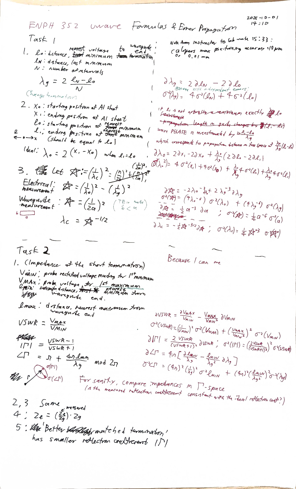
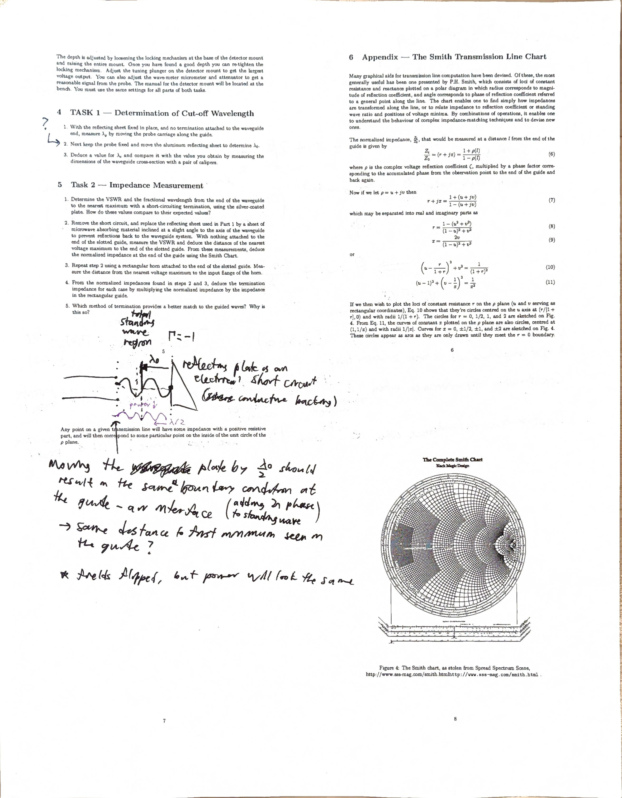
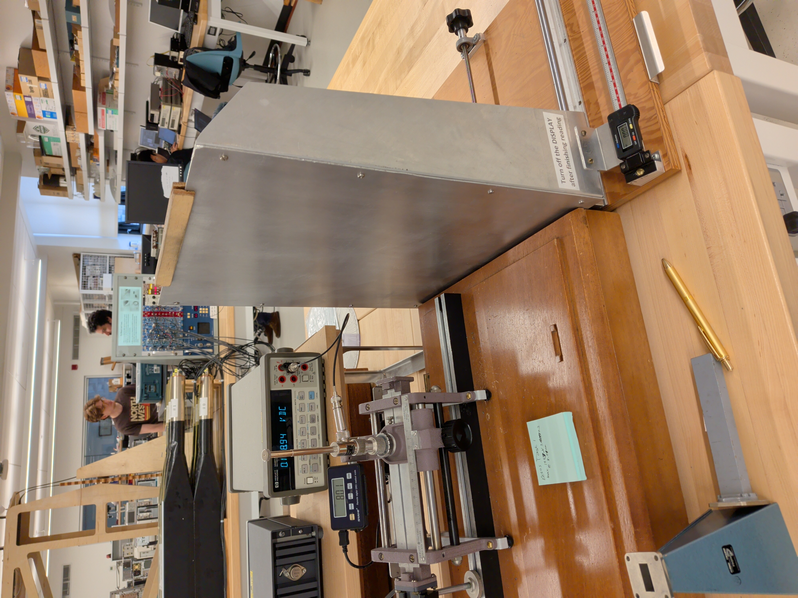

# 2026-10-01 (Second Lab Session)

## Intro
> **Summary of Last Time (2026-09-29)**: Created a plan for Task 1 and 2 calculations. I did not have time to write down the formulas with error propagation, or code them as I intended. 
>
> **Goal**: Write and code. Then, start the data collection with the physical setup.
> 
> **Approach**: When doing data collection, first check that the setup is correct (Cavity micrometer setting 2.960mm, with SILVER PLATE TERMINATION first two minima appearing at 8cm + 7.37mm and 29.7mm, and the first maximum appearing at 19.2mm which is about halfway in-between). Then, proceed with the Task 1 and 2 collection steps.
> 
> **Questions to start with**: Which is the aluminium and the silver sheet?

The question has an easy answer--the silver sheet is on a waveguide termination mount. A carriage with position meter placed after the waveguide holds up a plate, which on one side is the aluminium plate needed for Task 1, and on the other is the plate of microwave absorbing foam needed for Task 2.

Measurements in notebook, steps will be noted here.

14:10 start writing and coding.

15:10 writing the Task 2 formulas. Question: I am given a 'terminated wr90 short' as well as the silvered plate. What's the difference? What should I do with the wr90?

Google: that's a REALLY GOOD short termination, used for calibration purpose. The WR90 short will be much closer to true 0 impedance than the silver plate. I am not asked to use the short in this lab.

16:00 done with formulas, downloading my scan and setup images, also old scan images from previous days which I should've put into the earlier notebooks.

16:10 Starting measurement for Task 1: 

## Calibration
16:18 Checking centeredness of wave with the silvered plate termination: maxima are observed with the probe 3.43 mm and 22.01 mm from the guide end, and a minimum at 12.05 mm. The wave is centered. Surprisingly, the cavity micrometer had been set to 3.8 mm (very long), and the maxima read 193 mV each, which is much higher than during the last lab. Someone had found the right oscillator setup during the intervening week.

Minima measurements with silvered plate termination: 8cm + 12.05, 30.73, 49.43, 68.13, 86.82 mm +- 0.03 mm

(Ada updating 2026-10-11: calculation in my lab notes was wrong, the guide wavelength implied is 2*(86.82-12.05)/4 = 37.39mm. This turns out to have been accurate.)

## Task 1

Move plate as far forwards as possible on its slide and zero the scale. Push plate wooden platform until plate is abutting the waveguide platform. I will assume the waveguide is aligned to its platform. Now the plate is perpendicular.
...also move waveguide forward.

Probed first location minimum: 145 mV + 0.1 mV with the probe 8.01 mm from the start of the carriage.

Moving the plate back: I observed a maximum at 2.4 mm with value 146.8 +- 0.1 mV, and a second at 16.5 to 17.5 mm with a value of 146.2 +- 0.3 mV. I observed a minimum at 6.9mm with value 141.7 +- 0.1 mm. 

That is not even spacing.

## Reflection (Ada updating 2026-10-11)
> **Summary**: I wrote the calculation formulas and started Task 1 data collection. The Gunn diode oscillator had been recalibrated in my absence to a caliper setting of 3.800mm where the probe voltages were high and the voltage profile not bent in one direction, whereas my final setting of 2.860 mm fixed the voltage profile but the probe measured only 30 mV at maximum. I kept the new settings. I judge my measurements moving the reflecting plate during the last 10 minutes of lab unreliable.
>
> **Next Steps**: I had done the measurements in haste, and the flatness of the voltage profile versus reflecting plate position made locating minima extremely difficult. I thought it best not to think too much of this day's attempt to use the reflecting plate and return next week with enough time to manually measure the voltage at every 1mm step. Before leaving I checked the digital calipers and found no port to connect it to a computer, so I couldn't have automated measuring of the probe voltage vs position.
>
> **Outstanding Questions**: ...am I sure that moving the plate back is correct?