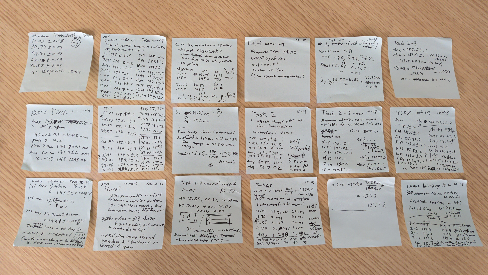
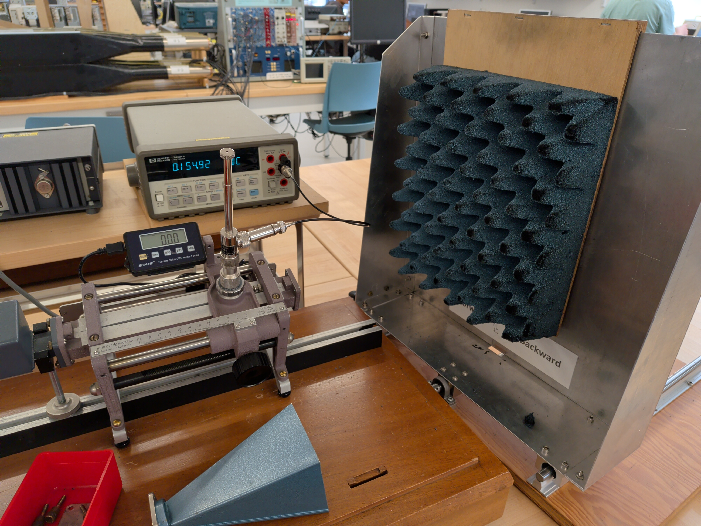
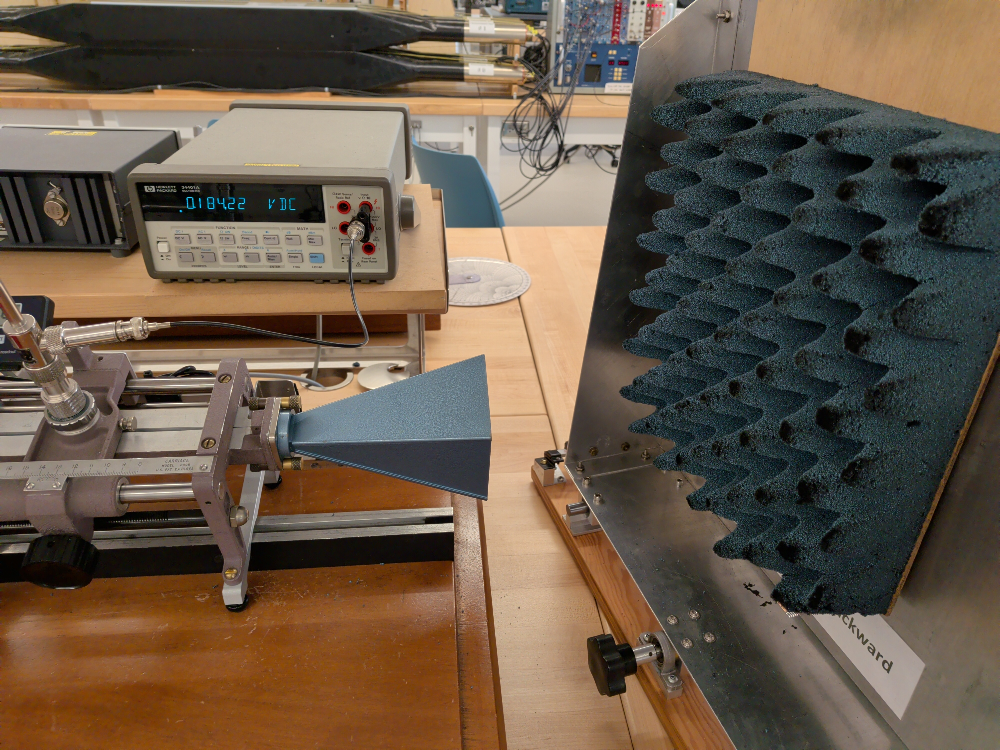
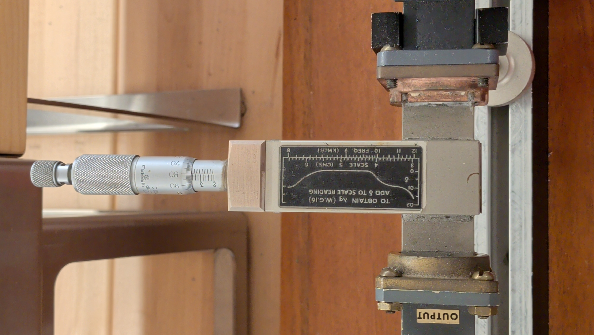
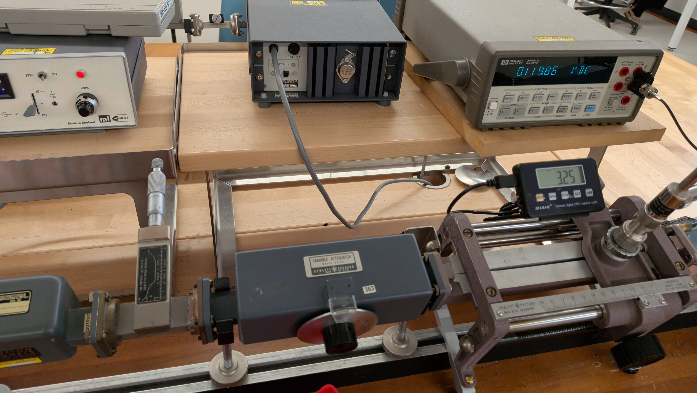
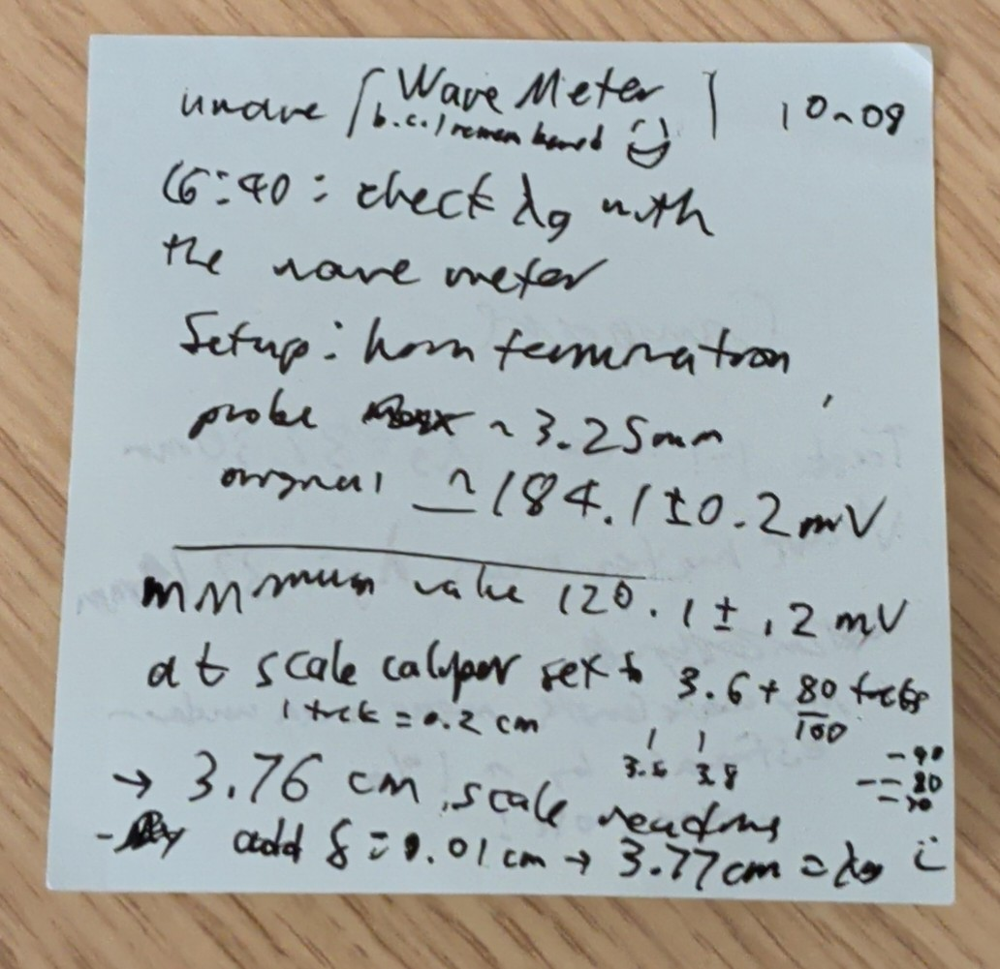
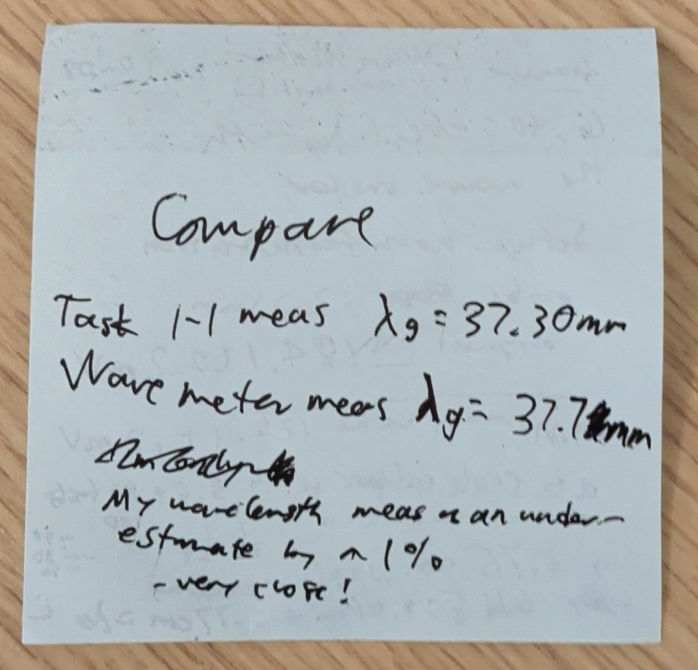
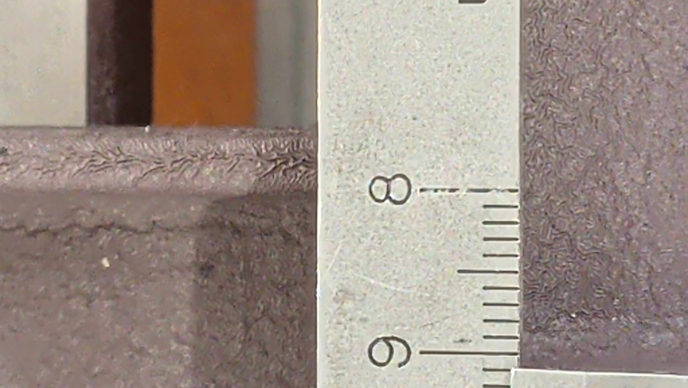
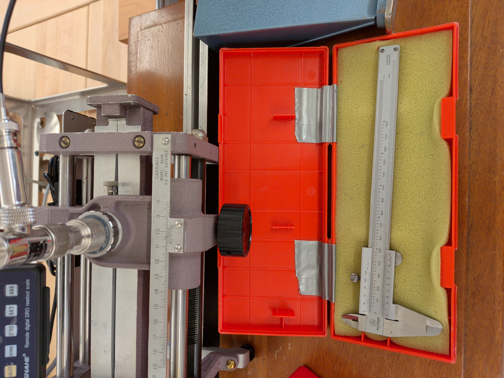

# 2026-10-08 Third Lab Session

## Intro (Ada writing 2026-10-11)
> **Summary of Last Time (2026-10-01)**: Gunn diode oscillator low probe voltage and bent voltage profile were both fixed by another user of the setup who set the caliper to 3.800 mm. I wrote down the formulas and error propagation for data collection based on my proposed approach from 09-29. Finally, data collection for Task 1 started haphazardly.
>
> **Goal**: Get through as much data collection today as possible. Ideally, get a complete first set of data, and perform the data analysis before the final lab session on Thursday Oct 15 to see if I need to attend.
> 
> **Approach**: Follow the steps for Task 1 and 2 data collection in [uwave_2026-09-29.md](uwave_2026-09-29.md), and later plug in data into to [Uwave-formulas.jpg](Enph352-uwave-images/Uwave-formulas.jpg). To home in on peak locations during Task 1 data collection, I will take the time to measure at fixed steps of 1mm reflecting plate movement. Even if the minima can't be identified by inspection, I can check if the voltage profile looks reasonable, and potentially use curve-fitting (quadratic function to n number of data points?) to locate the peaks.
>
> (Huh, that must be how physics labs performing really sensitive measurements work. Collect many data points and fit a model. SIMU lab is useful.)
> 
> **Questions to start with**: None, let's see if the approach works.

## Data Collection
All data recorded on sticky notes.

[Uwave-lab-data.jpg](Enph352-uwave-images/Uwave-lab-data.jpg)

Modification to lab procedure: I collected minima locations to determine $\lambda_g$ with the silver plate termination instead of exposure through air to the reflecting plate because I could locate precisely the extremely sharp 0-mV minima.

Task 2-2: I angled the microwave absorbing foam about 10° off-boresight from the waveguide axis in-line with the suggestion to avoid reflections back into the waveguide.

After completing data collection, I remembered that I wanted to use the wavemeter to measure the guide wavelength. It worked, and my estimated $\lambda_g$ from minima locations was only a 1% underestimate! (Wavemeter 3.77 cm, from minima locations 3.73 cm)

Additionally, the 3.76 cm scale reading matches with a frequency of betwwen ~~10.3 and 10.35 GHz~~ 10.6 GHz (2026-10-15: realized that I read the scale flipped) on the frequency scale. My $\lambda_0$ estimate from Task 1 implies a frequency of 10.53 GHz which is ~~2% greater~~ 1% less, which is not far off.

Though, if my uncertainty estimates imply that the wavemeter measurement is statistically inconsistent with my Task 1 work then I will need to investigate.

I had one question at the end of the lab: the 8cm mark from the carriage is located at 75.7 +- 0.3mm from the edge of the waveguide flange. I was not sure what to make of what appeared to me a discrepancy. I think the HP carriage was integrated by Sanders into this waveguide setup, so I would be surprised if they made a mistake. The information binder contained no description of the carriage apart from its part number HP809B inside the parts list for the entire X-band setup. 

I asked Prof. Ismail about this at the end of the lab session. The professor advises checking the original patent for more information if I'm curious to find out more. 

**For data analysis: assume a full 8.000 cm distance to the end of the waveguide, unless I can find a clear inconsistency.** 

I used an inner edge of the probe carriage to place one end of the calipers against.

## Reflection (Ada writing 2026-10-11)
> **Summary**: Data collection is a success. Guide wavelength estimate from Task 1 is close to what the wavemeter measures. 
>
> **Next Steps**: Create a notebook with the formulas and error propagation which I wrote down in [Uwave-formulas.jpg](Enph352-uwave-images/Uwave-formulas.jpg) and plug in my measurement data in [uwave-lab-data.jpg](Enph352-uwave-images/Uwave-lab-data.jpg). Consider locating minima by curve-fit. Check if my calculation results are well-supported and recollect data during the fourth lab session if I need to. 
>
> **Outstanding Questions**: Will the data I collected be good enough to complete my lab report?